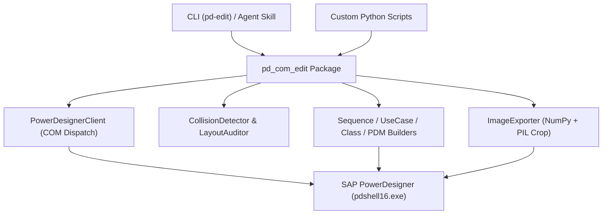

# powerdesigner-com-edit

[](https://opensource.org/licenses/MIT)
[](https://www.python.org/downloads/)
[](https://microsoft.com/windows)

PowerDesigner COM Edit (`powerdesigner-com-edit`) is a Python library and CLI tool for automating SAP PowerDesigner through its Windows COM interface (`PowerDesigner.Application`).

Working with PowerDesigner's COM API often comes with familiar headaches: activation bars on lifelines stack directly on top of each other into solid black rectangles, symbols overlap when placed programmatically, use case diagrams turn into tangled spiderwebs, and exported diagrams include excessive blank margins.

This project packages the layout math, diagram builders, collision checks, and export utilities we built to solve those exact issues.

---

## What It Does

- **Stack-Aware Sequence Diagram Layout**: Tracks call stacks across lifelines and applies a horizontal offset to nested calls (`X_offset = X_base + depth * 120`). This prevents re-entrant calls and replies from turning into solid black blocks.
- **Symbol Collision Checking**: Inspects symbol bounding boxes with a configurable clearance margin (default 150 units). Finds overlapping nodes, reports coordinates, and provides horizontal/vertical relaxation helpers.
- **Three-Column Use Case Layout**: Places primary actors on the left (`X = 0`), use cases in the center (`X = 14,000`), and secondary systems on the right (`X = 28,000`).
- **Physical & Conceptual Models (PDM / CDM)**: Programmatically creates tables, columns (data types, PK, nullability), foreign key references (`ReferenceJoin`), and multi-table layouts based on dependency levels.
- **Class Diagram Generation**: Adds classes, interfaces, attributes, methods with visibility markers (`+`, `-`, `#`), and hooks up inheritance and associations.
- **Smart Image Export**: Exports diagrams to PNG and trims surrounding white borders using NumPy and Pillow.
- **Draft Note Removal**: One-line cleanup to strip temporary course or review annotations (like "实现中" or "待整链验收") from models before submission.

---

## Architecture Overview



---

## Installation

### Requirements
- Windows 10 or 11
- SAP PowerDesigner 16.5, 16.6, or 16.7
- Python 3.8 or higher

```bash
git clone https://github.com/NekoCCN/powerdesigner-com-edit.git
cd powerdesigner-com-edit
pip install -e .
```

Or install the dependencies directly:
```bash
pip install -r requirements.txt
```

---

## Quick Examples

### 1. Build a Sequence Diagram without Activation Collisions

```python
from pd_com_edit import PowerDesignerClient, SequenceDiagramBuilder

client = PowerDesignerClient()
client.start(visible=True)

model = client.create_oom(name="AuthFlow")
diag = model.SequenceDiagrams.CreateNew()
diag.Name = "User Login Flow"

builder = SequenceDiagramBuilder(diag)
builder.add_lifeline("User", is_actor=True)
builder.add_lifeline("AuthUI")
builder.add_lifeline("AuthService")
builder.add_lifeline("UserDB")

builder.add_message("User", "AuthUI", "submitCredentials(user, pwd)", message_type="sync")
builder.add_message("AuthUI", "AuthService", "verify(user, pwd)", message_type="sync")
builder.add_message("AuthService", "UserDB", "selectUser(user)", message_type="sync")
builder.add_message("UserDB", "AuthService", "userRecord", message_type="reply")
builder.add_message("AuthService", "AuthUI", "loginSuccess(token)", message_type="reply")
builder.add_message("AuthUI", "User", "showDashboard()", message_type="reply")

builder.layout_diagram()
client.save_model(model, "auth_flow.oom")
```

### 2. Audit an Existing Model for Overlaps

```python
from pd_com_edit import PowerDesignerClient, LayoutAuditor

client = PowerDesignerClient()
client.start(visible=False)

model = client.open_model("system_model.oom")
auditor = LayoutAuditor()
report = auditor.audit_model(model)

print(report.get_summary())
if report.total_collisions > 0:
    for diag_name, collisions in report.collisions_by_diagram.items():
        for c in collisions:
            print(f"[{diag_name}] Conflict between {c.symbol1_name} and {c.symbol2_name}")
```

### 3. Build a PDM Schema with Foreign Keys

```python
from pd_com_edit import PowerDesignerClient, PdmBuilder

client = PowerDesignerClient()
client.start(visible=False)

model = client.create_pdm(name="WarehouseDB", dbms="PostgreSQL 12")
diag = model.PhysicalDiagrams.Item(0)

builder = PdmBuilder(model, diag)
builder.add_table("Department", "t_dept", [
    {"name": "ID", "code": "dept_id", "type": "INTEGER", "pk": True},
    {"name": "Name", "code": "dept_name", "type": "VARCHAR(64)", "mandatory": True}
], x=0, y=10000)

builder.add_table("Employee", "t_emp", [
    {"name": "ID", "code": "emp_id", "type": "INTEGER", "pk": True},
    {"name": "Name", "code": "emp_name", "type": "VARCHAR(64)"},
    {"name": "DeptID", "code": "dept_id", "type": "INTEGER"}
], x=14000, y=10000)

builder.add_reference("Department", "Employee", "dept_id", "dept_id", "FK_Emp_Dept")
builder.auto_layout()
client.save_model(model, "warehouse.pdm")
```

---

## CLI Usage (`pd-edit`)

The package registers a command-line tool `pd-edit`:

```bash
# Audit diagrams for overlaps and draft notes
pd-edit audit --model path/to/model.oom

# Strip draft annotations and save the model
pd-edit clean-notes --model path/to/model.oom --save

# Batch export all diagrams to PNG and crop white margins
pd-edit export --model path/to/model.oom --output-dir ./exports --crop

# Kill hanging PowerDesigner processes if COM crashed
pd-edit kill-pd
```

---

## Project Structure

```
powerdesigner-com-edit/
├── pd_com_edit/                  # Main package
│   ├── client.py                 # COM lifecycle and process helpers
│   ├── collision.py              # Bounding box collision detector and auditor
│   ├── sequence.py               # Sequence diagram builder with activation stacking
│   ├── usecase.py                # Three-column use case layout builder
│   ├── class_diagram.py          # Class diagram builder
│   ├── pdm.py                    # PDM tables, columns, references
│   ├── export.py                 # PNG export with Pillow/NumPy whitespace trimming
│   └── cli.py                    # pd-edit command line entrypoint
├── examples/                     # Ready-to-run examples
│   ├── 01_sequence_with_activation_bars.py
│   ├── 02_usecase_three_column_layout.py
│   ├── 03_pdm_database_schema.py
│   └── 04_batch_diagram_auditor.py
├── references/                   # Reference notes and cheat sheets
│   ├── com_api_cheatsheet.md
│   ├── overlap_detection_guide.md
│   ├── sequence_activation_guide.md
│   ├── pdm_database_modeling_guide.md
│   └── class_and_usecase_guide.md
├── scripts/
│   └── pd_automation.py          # Standalone single-file version
├── tests/
│   └── test_collision_detector.py# Offline tests (mock symbols, no PD required)
├── SKILL.md                      # Agent skill specification for Claude / Gemini
├── pyproject.toml
└── README.md
```

---

## 中文说明

`powerdesigner-com-edit` 是一个通过 Windows COM 接口（`PowerDesigner.Application`）操控 SAP PowerDesigner 的 Python 工具库与命令行小工具。

写脚本批量画 PowerDesigner 图时，通常会遇到几个非常具体的麻烦：
- 时序图里的激活条默认都贴在生命线正中，多个同步调用叠在一起直接渲染成一块死黑矩形；
- 编程式放置用例和角色时容易挤成一团，连线满天飞；
- 导出的 PNG 图片四周带着巨大的无用白边；
- 协作或课设模型里常常遗留诸如“实现中”、“待整链验收”之类的草稿文字框。

这个工具库把我们在解决这些实际问题时积累的代码整理成了通用的模块：

1. **时序图激活条阶梯对齐**：跟踪消息栈深度，在嵌套调用时自动施加横向偏移（`X_offset = X_base + depth * 120`），避免色块重叠。
2. **符号空间碰撞检测**：根据 AABB 包围盒和预留间距（默认 150 单位）排查重叠符号，并提供基本的行列自动松弛微调。
3. **三栏式用例图排版**：按“左侧人类角色（X=0）- 中间核心用例（X=14000）- 右侧外部系统（X=28000）”分栏摆放，连线走向清晰。
4. **PDM / CDM 数据库建模**：支持用 Python 批量建表、加字段、设置主键与非空、配置外键连线（`ReferenceJoin`）及多重度。
5. **类图分层生成**：支持类与接口、属性与方法可见性（`+`、`-`、`#`）、继承泛化与关联连线。
6. **自动裁切白边导出**：调用 COM 导出图片后，自动使用 NumPy 和 Pillow 检测背景像素并裁剪多余白边。
7. **草稿注释清理**：一键扫描并删除模型里的临时草稿注释框。
8. **命令行工具**：提供 `pd-edit`，直接在终端里跑 `audit`、`clean-notes`、`export` 和 `kill-pd`。

---

## License

MIT License. See [LICENSE](LICENSE) for details.
