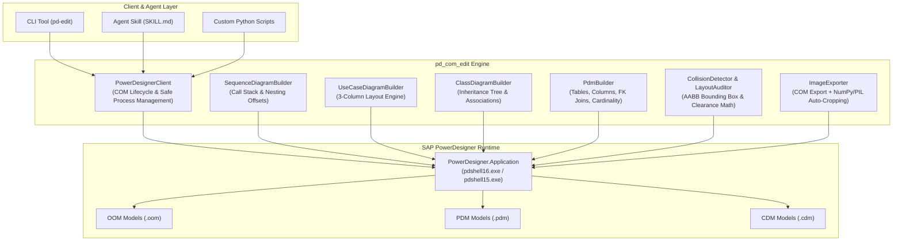

# powerdesigner-com-edit

[](https://opensource.org/licenses/MIT)
[](https://www.python.org/downloads/)
[](https://microsoft.com/windows)
[](https://www.sap.com)
[](https://github.com/psf/black)

> **English** | [中文说明](#中文说明)

**powerdesigner-com-edit** is an industrial-strength automation toolkit, Python library, CLI utility, and AI Agent Skill for SAP PowerDesigner. It programmatically generates, manipulates, audits, and exports Object-Oriented Models (OOM: Sequence, Use Case, Class), Physical Data Models (PDM), and Conceptual Data Models (CDM) via Windows COM Dispatch (`PowerDesigner.Application`).

---

## Key Highlights

- 📐 **Call-Stack Aware Activation Bar Engine**: Mathematically solves overlapping activation boxes and black blocks on lifelines using horizontal tier offsets ($X_{\text{offset}} = X_{\text{base}} + \text{depth} \times 120$).
- 🛡️ **AABB Collision Detection & Clearance Auditing**: Real-time bounding box intersection checks with clearance thresholding ($\delta \ge 150$) and auto-relaxation across vertical and horizontal planes.
- 🏛️ **3-Column Canonical Layout**: Eliminates spaghetti-web diagrams by organizing Use Case diagrams into Human Actors (Left), Use Cases (Center), and Secondary Systems (Right).
- 🗄️ **Relational PDM & CDM Modeling**: Programmatic generation of tables, columns, primary keys, foreign key joins, cardinality constraints, and dependency-tiered layouts.
- 🖼️ **Smart High-Resolution Cropping**: Exports vector-quality diagrams via COM and automatically removes blank margins with NumPy/PIL border trimming.
- 🧹 **Draft Note Cleaner**: Strips temporary, unapproved, or course-specific draft annotations from models with one command.
- 🤖 **Universal Agent Skill (`SKILL.md`)**: Fully compatible with Antigravity, Claude Code, and other LLM agent platforms.

---

## Architecture



---

## Installation

### Prerequisites
- Windows 10 / 11 / Windows Server
- SAP PowerDesigner 16.5, 16.6, or 16.7 installed and licensed
- Python 3.8 or later

### Install via pip
```bash
git clone https://github.com/NekoCCN/powerdesigner-com-edit.git
cd powerdesigner-com-edit
pip install -e .
```

Or install dependencies directly:
```bash
pip install -r requirements.txt
```

---

## Quick Start

### 1. Generate Sequence Diagram with Stack-Aware Activation Bars

```python
from pd_com_edit import PowerDesignerClient, SequenceDiagramBuilder

client = PowerDesignerClient()
client.start(visible=True)

model = client.create_oom(name="Authentication_Flow")
diag = model.SequenceDiagrams.CreateNew()
diag.Name = "User Login Flow"

builder = SequenceDiagramBuilder(diag)
builder.add_lifeline("User", is_actor=True)
builder.add_lifeline("AuthUI")
builder.add_lifeline("AuthService")
builder.add_lifeline("UserDB")

builder.add_message("User", "AuthUI", "submitCredentials(user, pwd)", message_type="sync")
builder.add_message("AuthUI", "AuthService", "verify(user, pwd)", message_type="sync")
builder.add_message("AuthService", "UserDB", "selectUser(user)", message_type="sync")
builder.add_message("UserDB", "AuthService", "userRecord", message_type="reply")
builder.add_message("AuthService", "AuthUI", "loginSuccess(token)", message_type="reply")
builder.add_message("AuthUI", "User", "showDashboard()", message_type="reply")

# Apply stack-aware layout and offset nested activation tiers
builder.layout_diagram()
client.save_model(model, "auth_flow.oom")
```

### 2. Audit Diagram Layout & Detect Collisions

```python
from pd_com_edit import PowerDesignerClient, LayoutAuditor

client = PowerDesignerClient()
client.start(visible=False)

model = client.open_model("my_system.oom")
auditor = LayoutAuditor()
report = auditor.audit_model(model)

print(report.get_summary())
if report.total_collisions > 0:
    for diag_name, collisions in report.collisions_by_diagram.items():
        for c in collisions:
            print(f"[{diag_name}] Conflict: {c.symbol1_name} <-> {c.symbol2_name} ({c.details})")
```

---

## CLI Reference (`pd-edit`)

The package includes a command-line utility `pd-edit` for rapid terminal operations:

```bash
# 1. Audit model for overlapping symbols and layout defects
pd-edit audit --model path/to/model.oom

# 2. Strip unapproved / draft notes from a model
pd-edit clean-notes --model path/to/model.oom --save

# 3. Batch export and auto-crop all diagrams as high-res PNG images
pd-edit export --model path/to/model.oom --output-dir ./exports --crop

# 4. Terminate lingering or frozen PowerDesigner processes
pd-edit kill-pd
```

---

## Repository Structure

```
powerdesigner-com-edit/
├── pd_com_edit/                  # Core Python package
│   ├── __init__.py               # Public API exports & package metadata
│   ├── client.py                 # PowerDesignerClient COM manager & process safety
│   ├── collision.py              # AABB collision detector & LayoutAuditor
│   ├── sequence.py               # SequenceDiagramBuilder (activation stack math)
│   ├── usecase.py                # UseCaseDiagramBuilder (3-column layout)
│   ├── class_diagram.py          # ClassDiagramBuilder (tree layout & relationships)
│   ├── pdm.py                    # PdmBuilder (tables, columns, foreign keys)
│   ├── export.py                 # ImageExporter (NumPy/PIL smart margin cropper)
│   └── cli.py                    # pd-edit command line interface
├── examples/                     # Runnable examples
│   ├── 01_sequence_with_activation_bars.py
│   ├── 02_usecase_three_column_layout.py
│   ├── 03_pdm_database_schema.py
│   └── 04_batch_diagram_auditor.py
├── references/                   # In-depth technical guides & mathematical models
│   ├── com_api_cheatsheet.md     # COM GUIDs, symbols, properties, and colors
│   ├── overlap_detection_guide.md# Bounding box math and activation formulas
│   ├── sequence_activation_guide.md # Call-stack state machine & fragment bounding
│   ├── pdm_database_modeling_guide.md # PDM/CDM modeling and FK constraints
│   └── class_and_usecase_guide.md# Canonical 3-column & class hierarchy rules
├── scripts/
│   └── pd_automation.py          # All-in-one drop-in script for standalone execution
├── tests/
│   └── test_collision_detector.py# Offline unit tests (no PowerDesigner required)
├── SKILL.md                      # Antigravity & Claude Code Agent Skill definition
├── pyproject.toml                # PEP 517 / 621 package configuration
├── requirements.txt              # Production dependencies
├── LICENSE                       # MIT License
└── README.md                     # Documentation
```

---

## 中文说明

**powerdesigner-com-edit** 是专为 SAP PowerDesigner 打造的企业级 COM 自动化工具包、Python 库、命令行工具及 AI Agent Skill。支持对面向对象模型（OOM：顺序图、用例图、类图）、物理数据模型（PDM）和概念数据模型（CDM）进行全自动的无重叠排版、激活条对齐、质量审计与高清裁剪导出。

### 核心特性
1. **调用栈感知激活条引擎**：解决顺序图中多个同步调用导致激活条重叠成黑色色块的痛点，按调用深度自动施加阶梯偏移（$X_{\text{offset}} = X_{\text{base}} + \text{depth} \times 120$）。
2. **AABB 空间碰撞检测与审计**：基于包围盒与间距阈值（$\delta \ge 150$）实时检测符号重叠，支持横向与纵向自动松弛重排。
3. **三栏式用例图规范排版**：严格按照「左侧人类角色 $\to$ 中间核心用例 $\to$ 右侧外部系统」规范布局，杜绝蜘蛛网式杂乱连线。
4. **关系型 PDM / CDM 建模**：支持编程式构建数据表、列、主键、外键引用（FK Joins）、多重度及拓扑分层网格排版。
5. **智能无边框高清导出**：通过 COM 导出矢量图，并结合 NumPy / PIL 自动检测背景像素裁切冗余白边。
6. **草稿注释批量清理**：一键扫描并清除模型中遗留的「实现中」、「待整链验收」等未受控标注。
7. **通用 Agent Skill (`SKILL.md`)**：原生适配 Antigravity、Claude Code 及其他大模型编程助手。

---

## License

This project is licensed under the [MIT License](LICENSE).
Copyright (c) 2026 Ext Culith (NekoCCN).
