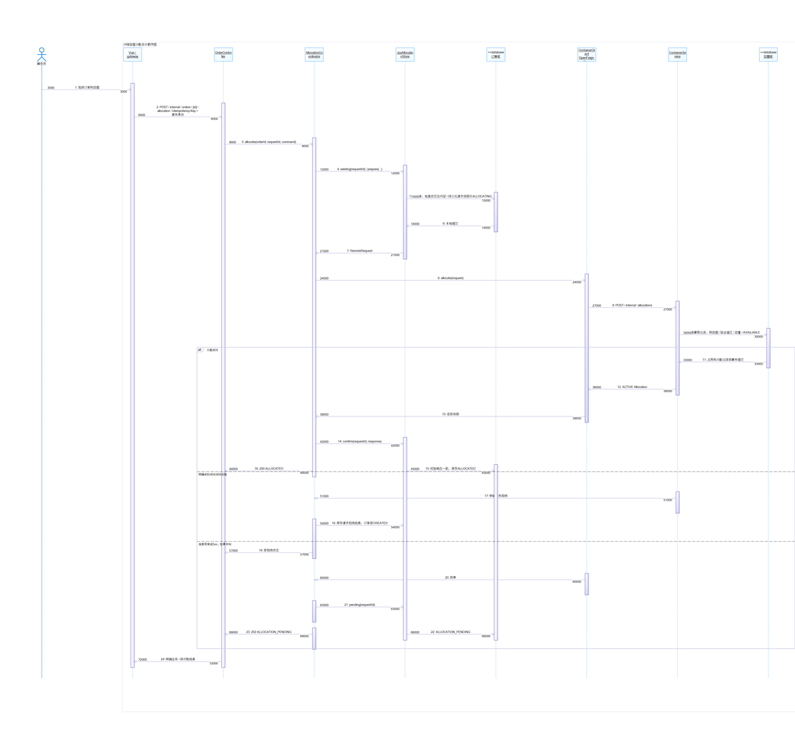
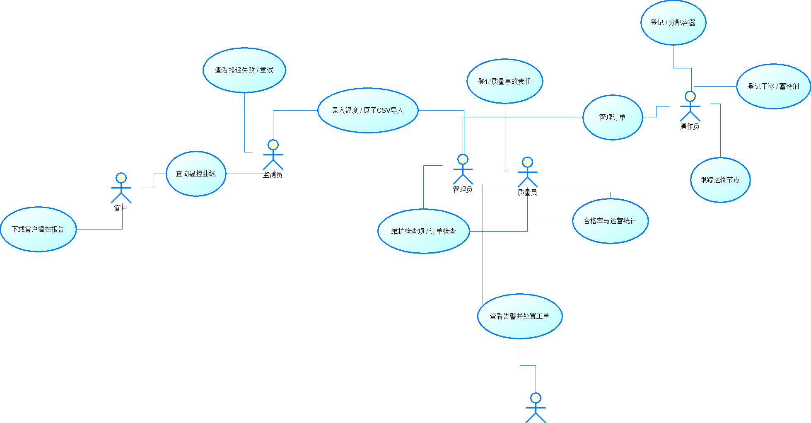
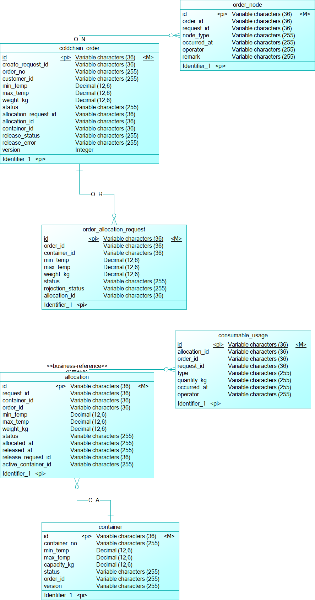
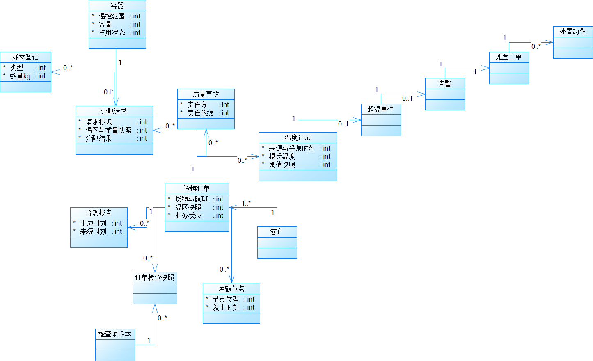
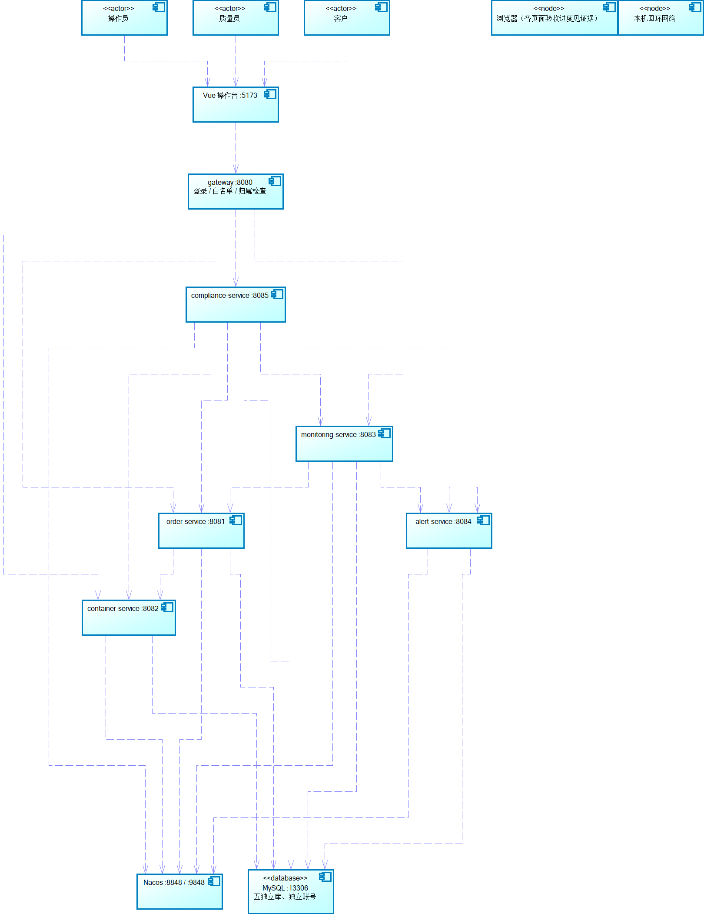

# powerdesigner-com-edit

[](https://opensource.org/licenses/MIT)
[](https://www.python.org/downloads/)
[](https://microsoft.com/windows)

PowerDesigner COM Edit (`powerdesigner-com-edit`) is an Agent Skill (`SKILL.md`) and Python automation toolkit for SAP PowerDesigner (16.5+). It enables AI coding assistants (such as Claude Code, Google Antigravity, and Codex) and human developers to programmatically generate, layout, audit, and export UML and database models via Windows COM (`PowerDesigner.Application`).

---

## Agent Skill Installation

This repository is designed from the ground up to be deployed as an **Agent Skill**. You can install it either at the **Project Level** (scoped to your current workspace/repository) or at the **Global User Level** (available to your agent across all projects).

### Option A: Project-Level Installation (Recommended for Teams & Repos)

Installing at the project level ensures that any AI coding assistant opened inside your project repository will immediately detect and use `powerdesigner-com-edit`, without requiring global system configuration:

```bash
# Inside your project root directory:
git clone https://github.com/NekoCCN/powerdesigner-com-edit.git

# Run the installer with --scope project
python powerdesigner-com-edit/install.py --scope project
```

This places the skill in the standard project agent skill directories:
- `.agents/skills/powerdesigner-com-edit` (Universal Agent standard)
- `.claude/skills/powerdesigner-com-edit` (Claude Code workspace skill)
- `.gemini/skills/powerdesigner-com-edit` (Antigravity workspace skill)

Or in PowerShell:
```powershell
powershell -ExecutionPolicy Bypass -File .\powerdesigner-com-edit\install.ps1 -Scope project
```

If you are developing or customizing the skill, use `--link` to create a live junction/symlink instead of copying:
```bash
python powerdesigner-com-edit/install.py --scope project --link
```

### Option B: Global User-Level Installation

Installs the skill into your user home directory so it is active in any terminal session:

```bash
git clone https://github.com/NekoCCN/powerdesigner-com-edit.git
cd powerdesigner-com-edit

# Install for all detected AI agents (Claude Code + Antigravity)
python install.py --scope global

# Or target a specific platform:
python install.py --target claude    # Only ~/.claude/skills
python install.py --target gemini    # Only ~/.gemini/skills
```

Windows PowerShell equivalent:
```powershell
powershell -ExecutionPolicy Bypass -File .\install.ps1 -Scope global
```

### Option C: Manual Git Clone

You can also clone the repository directly into your agent's skill path:

- **Claude Code (Global)**:
  ```bash
  git clone https://github.com/NekoCCN/powerdesigner-com-edit.git ~/.claude/skills/powerdesigner-com-edit
  ```
- **Antigravity / Gemini CLI (Global)**:
  ```bash
  git clone https://github.com/NekoCCN/powerdesigner-com-edit.git ~/.gemini/skills/powerdesigner-com-edit
  ```
- **Project-Local (Current Workspace)**:
  ```bash
  git clone https://github.com/NekoCCN/powerdesigner-com-edit.git .agents/skills/powerdesigner-com-edit
  ```

### Python Package & CLI Setup

If you want to run the CLI tool (`pd-edit`) or import `pd_com_edit` directly in Python scripts:
```bash
cd powerdesigner-com-edit
pip install -e .
```

---

## Generated Diagram Showcase (Real Production Outputs)

Below are actual diagram outputs generated using this toolkit and exported via COM with automatic white-border cropping.

### 1. Sequence Diagram: Multi-Tier Activation Alignment & Alt Fragment

Illustrates the stack-aware activation bar alignment. Re-entrant and concurrent calls received by services have horizontal tier offsets (`X_offset = X_base + depth * 120`), eliminating overlapping black blocks. Also showcases dynamic `alt` frame boundary calculation:



### 2. Use Case Diagram: Canonical Three-Column Layout

Demonstrates clean, orthogonal line routing without crossing lines. Primary Human Actors are positioned on the left, Core System Use Cases in the center, and External Systems on the right:



### 3. Physical Data Model (PDM): Relational Database Schema

PostgreSQL physical database model generated programmatically, featuring tables, columns, data types, primary key badges, and explicit foreign key relationship lines (`ReferenceJoin`) with cardinality constraints:



### 4. Domain Model: UML Class Hierarchy & Associations

Domain-Driven Design (DDD) class diagram modeling entities, value objects, aggregate roots, operations, visibility markers (`+`, `-`, `#`), and generalization links:



### 5. High-Level Architecture Blueprint

Multi-layer cold-chain monitoring system architecture generated directly through PowerDesigner COM automation:



---

## How Agents Use This Skill

Once installed, your coding assistant will automatically trigger this skill whenever you ask it to:
- Generate sequence diagrams with activation bars that do not overlap into solid black boxes.
- Create 3-column use case diagrams (Actors on left, Use Cases in center, External Systems on right).
- Build Physical Data Models (PDM) with primary keys, foreign key joins, and cardinality.
- Audit diagrams for AABB symbol overlaps or clean up leftover draft notes.
- Batch export cropped, high-resolution PNG diagrams for reports.

Example agent prompts:
- *"Use powerdesigner-com-edit to create a sequence diagram for our container allocation flow."*
- *"Check if any symbols or activation bars overlap in my_model.oom and fix them."*
- *"Build a PDM schema for our order and container tables with foreign key joins."*
- *"Clean up any draft notes from the diagrams and export all views to PNG."*

---

## Core Capabilities

- **Stack-Aware Activation Bar Alignment**: Tracks nested call depth and shifts concurrent activation bars horizontally (`X_offset = X_base + depth * 120`). Prevents overlapping calls from rendering as solid black blocks.
- **AABB Collision Detection & Spacing Audit**: Checks bounding boxes with clearance buffers (default 150 units). Finds colliding symbols and provides auto-relaxation algorithms.
- **Three-Column Use Case Layout**: Canonical layout with Primary Actors on the left (`X = 0`), Core Use Cases in the center (`X = 14,000`), and Secondary Systems on the right (`X = 28,000`).
- **Physical & Conceptual Models (PDM / CDM)**: Programmatic generation of tables, columns, primary keys, foreign key joins (`ReferenceJoin`), and multi-tier layout.
- **Class Diagram Hierarchy**: Builds classes, interfaces, attributes, methods with visibility markers (`+`, `-`, `#`), and association/inheritance links.
- **Smart Image Export**: Exports diagrams via COM and trims surrounding whitespace margins with NumPy and Pillow.
- **Draft Note Removal**: One-command cleanup for stray notes left behind during development (e.g. "实现中" or "待整链验收").

---

## Code Examples

### Example 1: Multi-Tier Microservice Sequence Diagram

Demonstrates a real-world cold-chain container allocation flow across Dispatcher, API Gateway, Allocation Service, Route Optimization Engine, and Database:

```python
from pd_com_edit import PowerDesignerClient, SequenceDiagramBuilder

client = PowerDesignerClient()
client.start(visible=True)

model = client.create_oom(name="ColdChainLogistics")
diag = model.SequenceDiagrams.CreateNew()
diag.Name = "Container Allocation Flow"

builder = SequenceDiagramBuilder(diag)

# Register lifelines across system layers
builder.add_lifeline("Dispatcher", is_actor=True)
builder.add_lifeline("APIGateway")
builder.add_lifeline("AllocationService")
builder.add_lifeline("RouteOptimizer")
builder.add_lifeline("ContainerDB")

# Message exchanges with nested activation stacking
builder.add_message("Dispatcher", "APIGateway", "allocateContainers(orderId, tempZone)", message_type="sync")
builder.add_message("APIGateway", "AllocationService", "POST /api/allocations", message_type="sync")

# Nested calls (depth = 1)
builder.add_message("AllocationService", "RouteOptimizer", "solveVRP(order, constraints)", message_type="sync")
builder.add_message("RouteOptimizer", "AllocationService", "optimalRoutePlan", message_type="reply")

# Database persistence (depth = 1)
builder.add_message("AllocationService", "ContainerDB", "lockAndAssign(containerIds)", message_type="sync")
builder.add_message("ContainerDB", "AllocationService", "assignmentCommitted", message_type="reply")

# Returns back to caller
builder.add_message("AllocationService", "APIGateway", "201 Created (summary)", message_type="reply")
builder.add_message("APIGateway", "Dispatcher", "renderAllocationSuccess()", message_type="reply")

# Apply stack-aware layout
builder.layout_diagram()
client.save_model(model, "cold_chain_allocation.oom")
```

### Example 2: Three-Column Use Case Layout

Organizes 3 human roles, 5 core use cases, and 3 external systems without crossing lines:

```python
from pd_com_edit import PowerDesignerClient, UseCaseDiagramBuilder

client = PowerDesignerClient()
client.start(visible=False)

model = client.create_oom(name="Hospital_UseCases")
diag = model.UseCaseDiagrams.Item(0)

builder = UseCaseDiagramBuilder(diag)

# Left column: Primary Actors (X = 0)
builder.add_actor("Patient", is_primary=True)
builder.add_actor("Doctor", is_primary=True)
builder.add_actor("Nurse", is_primary=True)

# Center column: Core Use Cases (X = 14,000)
builder.add_usecase("Register Online Appointment")
builder.add_usecase("Verify Insurance Coverage")
builder.add_usecase("Conduct Clinical Examination")
builder.add_usecase("Prescribe Medication")
builder.add_usecase("Discharge Patient")

# Right column: External Systems (X = 28,000)
builder.add_system("National Insurance API")
builder.add_system("Pharmacy Warehouse")
builder.add_system("SMS Notification Service")

# Connect relationships cleanly
builder.connect("Patient", "Register Online Appointment")
builder.connect("Patient", "Verify Insurance Coverage")
builder.connect("Verify Insurance Coverage", "National Insurance API")
builder.connect("Doctor", "Conduct Clinical Examination")
builder.connect("Doctor", "Prescribe Medication")
builder.connect("Prescribe Medication", "Pharmacy Warehouse")
builder.connect("Nurse", "Discharge Patient")
builder.connect("Discharge Patient", "SMS Notification Service")

builder.layout_three_column()
client.save_model(model, "hospital_usecases.oom")
```

### Example 3: Relational Database Schema with Foreign Keys

Generates a PostgreSQL Physical Data Model with lookup tables, business entities, transaction tables, and explicit foreign key joins:

```python
from pd_com_edit import PowerDesignerClient, PdmBuilder

client = PowerDesignerClient()
client.start(visible=False)

model = client.create_pdm(name="WarehouseSchema", dbms="PostgreSQL 12")
diag = model.PhysicalDiagrams.Item(0)

builder = PdmBuilder(model, diag)

# Table 1: Category (Lookup Table)
builder.add_table("Product Category", "t_category", [
    {"name": "Category ID", "code": "category_id", "type": "INTEGER", "pk": True},
    {"name": "Code", "code": "cat_code", "type": "VARCHAR(32)", "mandatory": True},
    {"name": "Name", "code": "cat_name", "type": "VARCHAR(128)", "mandatory": True}
], x=0, y=10000)

# Table 2: Product (Core Entity)
builder.add_table("Product", "t_product", [
    {"name": "Product ID", "code": "product_id", "type": "BIGINT", "pk": True},
    {"name": "SKU", "code": "sku", "type": "VARCHAR(64)", "mandatory": True},
    {"name": "Price", "code": "price", "type": "DECIMAL(12,2)", "mandatory": True},
    {"name": "Category ID", "code": "category_id", "type": "INTEGER", "mandatory": True}
], x=14000, y=10000)

# Table 3: Order Item (Transaction Table)
builder.add_table("Order Item", "t_order_item", [
    {"name": "Item ID", "code": "item_id", "type": "BIGINT", "pk": True},
    {"name": "Order ID", "code": "order_id", "type": "BIGINT", "mandatory": True},
    {"name": "Product ID", "code": "product_id", "type": "BIGINT", "mandatory": True},
    {"name": "Quantity", "code": "quantity", "type": "INTEGER", "mandatory": True}
], x=28000, y=10000)

# Establish Foreign Key Joins
builder.add_reference("Product Category", "Product", "category_id", "category_id", "FK_Product_Category")
builder.add_reference("Product", "Order Item", "product_id", "product_id", "FK_Item_Product")

builder.auto_layout()
client.save_model(model, "warehouse_schema.pdm")
```

### Example 4: Layout Audit & Whitespace-Cropped Export Pipeline

Audits an existing model for symbol collisions, cleans up draft notes, and batch-exports trimmed diagrams:

```python
from pd_com_edit import PowerDesignerClient, LayoutAuditor, CollisionDetector, ImageExporter

client = PowerDesignerClient()
client.start(visible=False)

model = client.open_model("lab_assignment.oom")

# Step 1: Strip draft notes left during modeling
cleaned = CollisionDetector.strip_draft_notes(model)
print(f"Removed {cleaned} draft annotations.")

# Step 2: Audit remaining diagrams for symbol overlaps
auditor = LayoutAuditor()
report = auditor.audit_model(model)
print(report.get_summary())

# Step 3: Batch export diagrams with auto-cropped margins
exporter = ImageExporter(output_dir="./exports", crop_margins=True, padding=20)
exported_files = exporter.export_model_diagrams(model)
for f in exported_files:
    print(f"Exported clean diagram: {f}")

client.save_model(model)
client.close_model(model)
```

---

## CLI Reference (`pd-edit`)

```bash
# Check model for symbol overlaps and draft notes
pd-edit audit --model path/to/model.oom

# Strip unapproved draft notes and save
pd-edit clean-notes --model path/to/model.oom --save

# Export diagrams to PNG and remove blank borders
pd-edit export --model path/to/model.oom --output-dir ./exports --crop

# Terminate hanging PowerDesigner processes
pd-edit kill-pd
```

---

## Project Structure

```
powerdesigner-com-edit/
├── SKILL.md                      # Agent Skill specification (Claude Code & Antigravity)
├── install.py                    # Multi-platform & project-level skill installer
├── install.ps1                   # PowerShell installer script
├── docs/                         # Documentation assets & real production diagrams
│   └── images/
│       ├── sequence-activation-bars.png
│       ├── use-case-three-column.png
│       ├── pdm-entity-relationship.png
│       ├── domain-class-model.png
│       └── system-architecture.png
├── pd_com_edit/                  # Core Python package
│   ├── client.py                 # COM lifecycle and process safety
│   ├── collision.py              # AABB collision detector and auditor
│   ├── sequence.py               # Sequence builder with activation bar stacking
│   ├── usecase.py                # 3-column use case layout builder
│   ├── class_diagram.py          # Class diagram builder
│   ├── pdm.py                    # PDM tables, columns, references
│   ├── export.py                 # PNG export with Pillow/NumPy cropping
│   └── cli.py                    # pd-edit CLI tool
├── examples/                     # Ready-to-run examples
│   ├── 01_sequence_with_activation_bars.py
│   ├── 02_usecase_three_column_layout.py
│   ├── 03_pdm_database_schema.py
│   ├── 04_batch_diagram_auditor.py
│   ├── 05_cold_chain_allocation_pipeline.py
│   └── 06_domain_model_class_hierarchy.py
├── references/                   # Reference notes and cheat sheets
│   ├── com_api_cheatsheet.md
│   ├── overlap_detection_guide.md
│   ├── sequence_activation_guide.md
│   ├── pdm_database_modeling_guide.md
│   └── class_and_usecase_guide.md
├── scripts/
│   └── pd_automation.py          # Standalone all-in-one script
├── tests/
│   └── test_collision_detector.py# Offline unit tests
├── pyproject.toml
└── README.md
```

---

## 中文说明

`powerdesigner-com-edit` 既是一个标准的 **AI Agent Skill**（适配 Claude Code、Google Antigravity、Codex 等），也是一套可以通过 Windows COM 接口（`PowerDesigner.Application`）操控 SAP PowerDesigner 的 Python 工具库与命令行工具。

### Skill 安装与配置

#### 1. 项目级别安装（推荐项目内使用）
针对具体开发仓库或团队协同，直接安装到工程目录中，仓库成员拉取后无需配置全局环境，AI 助手在当前项目下即可直接激活本技能：

```bash
# 在当前工程根目录下执行：
python path/to/powerdesigner-com-edit/install.py --scope project
```
安装器会自动将 Skill 部署到项目本地目录：
- `.agents/skills/powerdesigner-com-edit`
- `.claude/skills/powerdesigner-com-edit`
- `.gemini/skills/powerdesigner-com-edit`

若希望以软链接（Junction / Symlink）形式安装以便随时跟踪技能代码更新，可追加 `--link` 参数。

#### 2. 全局用户级别安装
在当前机器的用户主目录下全局生效：
```bash
python install.py --scope global
```
或在 Windows PowerShell 中直接运行：
```powershell
powershell -ExecutionPolicy Bypass -File .\install.ps1 -Scope global
```

#### 3. 生产实例画廊
README 正文中已嵌入通过本工具生成的 5 张真实图表实例（包含冷链调度嵌套时序图、规范三栏用例图、PostgreSQL 物理数据模型 ER 连线、领域驱动类图以及高层架构图），展示了调用栈激活条对齐、连线防交叉排版以及无白边高清导出的真实效果。

---

## License

MIT License. See [LICENSE](LICENSE) for details.
